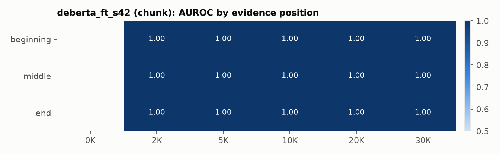
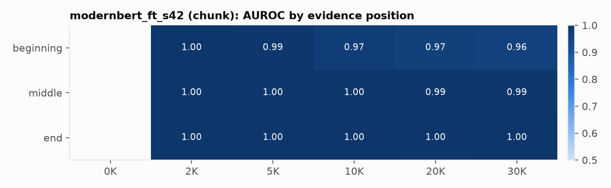

# Length-robust hallucination detection on PHANTOM, RAGTruth and HaluEval

_Generated 2026-10-21 by `python -m src.cli report` from the committed `artifacts/`._

**Pipeline status.** Done: prepare, baselines, rewrite-halueval, score-smoke, score-zeroshot, probe-jev, judge-jev, finetune, evaluate, report. Pending: probe-api, judges-api, score-finetuned, judge-local. Sections that depend on pending stages say so explicitly.

## Research question

How do hallucination detectors degrade as the context grows from a ~500-token passage to 30K nominal tokens and as the evidence moves to the beginning, middle or end, and does chunked or retrieval-based verification recover the loss? Every detector is evaluated next to answer-only shortcut baselines, because all three benchmarks can be partly solved without reading the context.

## Shortcut audit

AUROC of baselines trained on each benchmark's training split. `answer_length` and `answer_tfidf` never see the context; `lexical_support` is 1 minus the share of the answer's content words found in the context. PHANTOM baselines are trained on 8-K/497K and tested on 10-K/DEF 14A at every length.

| eval | answer_length | answer_tfidf | lexical_support |
|---|---|---|---|
| halueval_norm_test | 0.643 | 0.703 | 0.672 |
| halueval_test | 0.982 | 0.968 | 0.895 |
| phantom_grid_full | 0.835 | 0.957 | 0.836 |
| ragtruth_test | 0.685 | 0.808 | 0.783 |

A detector only demonstrates that it uses the context where it beats the answer-only line, or on the length-matched hard subset where the answer-only signal is weaker.

## Data

- HaluEval QA: 10000 questions (20000 rows). RAGTruth: 14942 train / 2675 test responses.
- PHANTOM: 4 seed files plus 30 long-context files (10-K and DEF 14A at 2K-30K tokens x 3 positions). Long rows are joined to their seed pair; 2086 of 13462 long-file pairs have answers regenerated relative to the seed (`variant=reanswered`; 10k: 0 of 6757 (0%); def14a: 2086 of 6705 (31%)).
- Splits are grouped by pair: PHANTOM 10-K and DEF 14A are test-only at every length; 8-K/497K are train/val; HaluEval 70/15/15; RAGTruth official test, train split 85/15. `grid_sub` = 200 pairs per test filing present in every cell.
- Full statistics and tokenizer measurements: [`artifacts/data_card.md`](../artifacts/data_card.md).

## Results

AUROC with 95% pair-clustered bootstrap CIs. Thresholds for F1 and balanced accuracy are chosen on validation slices only.

| detector | strategy | halueval_norm_test | halueval_test | phantom_grid_full | phantom_grid_full (hard) | phantom_grid_sub | phantom_grid_sub (hard) | phantom_seed_test | phantom_seed_test (hard) | ragtruth_test |
|---|---|---|---|---|---|---|---|---|---|---|
| answer_length | none | 0.643 [0.628, 0.658] | 0.982 [0.977, 0.986] | 0.835 [0.820, 0.850] | 0.732 [0.713, 0.755] | nan | nan | nan | nan | 0.685 [0.663, 0.707] |
| answer_tfidf | none | 0.703 [0.688, 0.718] | 0.968 [0.962, 0.974] | 0.957 [0.950, 0.965] | 0.888 [0.869, 0.908] | nan | nan | nan | nan | 0.808 [0.787, 0.828] |
| deberta_ft_s42 | chunk-w400-o128-min_phalluc | 0.972 [0.966, 0.977] | nan | nan | nan | 0.998 [0.996, 0.999] | 0.991 [0.984, 0.997] | nan | nan | 0.864 [0.846, 0.879] |
| deberta_ft_s42 | truncate-w400 | 0.972 [0.966, 0.977] | nan | nan | nan | 0.990 [0.986, 0.994] | 0.966 [0.950, 0.979] | nan | nan | 0.873 [0.856, 0.889] |
| deberta_ft_s42_ablate | truncate-w400__ablate | 0.693 [0.678, 0.709] | nan | nan | nan | nan | nan | 0.978 [0.973, 0.982] | 0.914 [0.897, 0.930] | 0.552 [0.524, 0.581] |
| deberta_nli | chunk-w400-o128-min_phalluc | nan | 0.799 [0.784, 0.813] | nan | nan | 0.600 [0.584, 0.614] | 0.553 [0.535, 0.572] | nan | nan | 0.592 [0.568, 0.615] |
| deberta_nli | retrieve-w400-o128-min_phalluc-k3-bidf | nan | 0.799 [0.784, 0.813] | nan | nan | 0.698 [0.677, 0.717] | 0.654 [0.625, 0.682] | nan | nan | 0.596 [0.573, 0.619] |
| deberta_nli | truncate-w400 | nan | 0.799 [0.784, 0.813] | nan | nan | 0.535 [0.523, 0.547] | 0.525 [0.510, 0.543] | nan | nan | 0.597 [0.574, 0.621] |
| hhem | chunk-w2048-o1024-min_phalluc | nan | 0.737 [0.723, 0.751] | nan | nan | 0.701 [0.675, 0.727] | 0.831 [0.796, 0.863] | nan | nan | 0.824 [0.806, 0.841] |
| hhem | retrieve-w2048-o1024-min_phalluc-k2-bidf | nan | 0.737 [0.723, 0.751] | nan | nan | 0.698 [0.672, 0.725] | 0.828 [0.793, 0.861] | nan | nan | 0.824 [0.806, 0.841] |
| hhem | truncate-w2048 | nan | 0.737 [0.723, 0.751] | nan | nan | 0.552 [0.542, 0.562] | 0.586 [0.574, 0.599] | nan | nan | 0.824 [0.806, 0.841] |
| hhem_ablate | truncate-w2048__ablate | nan | 0.319 [0.302, 0.334] | nan | nan | nan | nan | 0.384 [0.365, 0.405] | 0.502 [0.475, 0.529] | 0.395 [0.371, 0.420] |
| jev_choice | chunk-w16000-o2048-min_phalluc | nan | 0.920 [0.903, 0.935] | nan | nan | 0.969 [0.946, 0.986] | 0.966 [0.926, 0.992] | nan | nan | 0.925 [0.905, 0.945] |
| jev_choice | retrieve-w1500-o750-min_phalluc-k2 | nan | 0.920 [0.903, 0.935] | nan | nan | 0.930 [0.909, 0.948] | 0.937 [0.903, 0.963] | nan | nan | 0.928 [0.908, 0.946] |
| jev_choice | retrieve-w1500-o750-min_phalluc-k2-bidf | nan | 0.920 [0.903, 0.935] | nan | nan | 0.968 [0.947, 0.986] | 0.975 [0.941, 0.997] | nan | nan | 0.928 [0.908, 0.946] |
| jev_choice | truncate-w16000 | nan | 0.920 [0.903, 0.935] | nan | nan | 0.832 [0.813, 0.849] | 0.839 [0.806, 0.866] | nan | nan | 0.925 [0.905, 0.945] |
| jev_choice_full | retrieve-w1500-o750-min_phalluc-k2-bidf | nan | nan | nan | nan | 0.973 [0.965, 0.981] | 0.979 [0.964, 0.990] | nan | nan | nan |
| jev_noul | chunk-w16000-o2048-min_phalluc | nan | 0.945 [0.931, 0.956] | nan | nan | 0.969 [0.946, 0.986] | 0.961 [0.919, 0.990] | nan | nan | 0.926 [0.906, 0.945] |
| jev_noul | retrieve-w1500-o750-min_phalluc-k2 | nan | 0.945 [0.931, 0.956] | nan | nan | 0.930 [0.909, 0.948] | 0.935 [0.901, 0.961] | nan | nan | 0.929 [0.910, 0.947] |
| jev_noul | retrieve-w1500-o750-min_phalluc-k2-bidf | nan | 0.945 [0.931, 0.956] | nan | nan | 0.968 [0.946, 0.986] | 0.972 [0.938, 0.997] | nan | nan | 0.929 [0.910, 0.947] |
| jev_noul | truncate-w16000 | nan | 0.945 [0.931, 0.956] | nan | nan | 0.840 [0.821, 0.856] | 0.844 [0.811, 0.872] | nan | nan | 0.926 [0.906, 0.945] |
| jev_noul_ablate | truncate-w16000__ablate | nan | 0.654 [0.624, 0.681] | nan | nan | nan | nan | 0.746 [0.720, 0.774] | 0.678 [0.636, 0.726] | 0.518 [0.504, 0.533] |
| jev_noul_ablate_full | truncate-w16000__ablate | nan | nan | nan | nan | 0.742 [0.718, 0.765] | 0.688 [0.651, 0.728] | nan | nan | nan |
| jev_noul_full | retrieve-w1500-o750-min_phalluc-k2-bidf | nan | nan | nan | nan | 0.974 [0.966, 0.982] | 0.978 [0.962, 0.989] | nan | nan | nan |
| lettucedetect | chunk-w3584-o1536-min_phalluc | nan | 0.823 [0.808, 0.837] | nan | nan | 0.733 [0.711, 0.755] | 0.809 [0.780, 0.839] | nan | nan | 0.883 [0.866, 0.898] |
| lettucedetect | retrieve-w3584-o1536-min_phalluc-k2-bidf | nan | 0.823 [0.808, 0.837] | nan | nan | 0.727 [0.704, 0.749] | 0.816 [0.786, 0.847] | nan | nan | 0.883 [0.866, 0.898] |
| lettucedetect | truncate-w3584 | nan | 0.823 [0.808, 0.837] | nan | nan | 0.641 [0.628, 0.655] | 0.649 [0.631, 0.668] | nan | nan | 0.883 [0.866, 0.898] |
| lexical_support | full_context | 0.672 [0.659, 0.684] | 0.895 [0.881, 0.907] | 0.836 [0.819, 0.852] | 0.814 [0.796, 0.832] | nan | nan | nan | nan | 0.783 [0.764, 0.803] |
| modernbert_answeronly_s42 | truncate-w7168__ablate | 0.850 [0.836, 0.863] | nan | nan | nan | 0.993 [0.989, 0.997] | 0.975 [0.957, 0.991] | 0.992 [0.988, 0.995] | 0.971 [0.960, 0.982] | 0.811 [0.791, 0.830] |
| modernbert_answeronly_s43 | truncate-w7168__ablate | 0.856 [0.843, 0.868] | nan | nan | nan | 0.991 [0.986, 0.995] | 0.968 [0.950, 0.983] | 0.992 [0.989, 0.994] | 0.970 [0.957, 0.980] | 0.815 [0.795, 0.833] |
| modernbert_answeronly_s44 | truncate-w7168__ablate | 0.856 [0.843, 0.868] | nan | nan | nan | 0.990 [0.984, 0.994] | 0.964 [0.944, 0.980] | 0.992 [0.989, 0.995] | 0.972 [0.961, 0.981] | 0.815 [0.796, 0.833] |
| modernbert_ft_s42 | chunk-w7168-o2048-min_phalluc | 0.963 [0.956, 0.969] | 0.936 [0.927, 0.945] | nan | nan | 0.991 [0.988, 0.994] | 0.968 [0.957, 0.978] | 0.999 [0.999, 1.000] | 0.999 [0.997, 0.999] | 0.896 [0.883, 0.909] |
| modernbert_ft_s42 | retrieve-w2048-o1024-min_phalluc-k2-bidf | 0.963 [0.956, 0.969] | 0.936 [0.927, 0.945] | nan | nan | 0.998 [0.996, 1.000] | 0.992 [0.985, 0.998] | 0.999 [0.999, 1.000] | 0.999 [0.997, 0.999] | 0.896 [0.883, 0.909] |
| modernbert_ft_s42 | truncate-w7168 | 0.963 [0.956, 0.969] | 0.936 [0.927, 0.945] | nan | nan | 0.981 [0.976, 0.986] | 0.930 [0.916, 0.944] | 0.999 [0.999, 1.000] | 0.999 [0.997, 0.999] | 0.896 [0.883, 0.909] |
| modernbert_ft_s42_ablate | truncate-w7168__ablate | 0.762 [0.747, 0.777] | nan | nan | nan | nan | nan | 0.908 [0.897, 0.919] | 0.784 [0.760, 0.809] | 0.639 [0.614, 0.664] |
| modernbert_ft_s43 | chunk-w7168-o2048-min_phalluc | 0.967 [0.960, 0.972] | nan | nan | nan | nan | nan | 0.999 [0.998, 1.000] | 0.997 [0.994, 0.999] | 0.897 [0.883, 0.911] |
| modernbert_ft_s44 | chunk-w7168-o2048-min_phalluc | 0.964 [0.957, 0.971] | nan | nan | nan | nan | nan | 0.998 [0.996, 0.999] | 0.993 [0.988, 0.998] | 0.892 [0.877, 0.906] |
| modernbert_nli | chunk-w1536-o1024-min_phalluc | nan | 0.826 [0.814, 0.839] | nan | nan | 0.746 [0.723, 0.769] | 0.706 [0.682, 0.736] | nan | nan | 0.767 [0.749, 0.788] |
| modernbert_nli | retrieve-w1536-o1024-min_phalluc-k2-bidf | nan | 0.826 [0.814, 0.839] | nan | nan | 0.740 [0.716, 0.762] | 0.705 [0.680, 0.735] | nan | nan | 0.767 [0.749, 0.787] |
| modernbert_nli | truncate-w1536 | nan | 0.826 [0.814, 0.839] | nan | nan | 0.514 [0.503, 0.524] | 0.539 [0.530, 0.547] | nan | nan | 0.766 [0.748, 0.786] |
| modernbert_nli_ablate | truncate-w1536__ablate | nan | 0.256 [0.241, 0.271] | nan | nan | nan | nan | 0.244 [0.225, 0.262] | 0.465 [0.446, 0.483] | 0.578 [0.551, 0.604] |

### phantom_grid_sub: AUROC vs context length (all pairs)

### phantom_grid_sub: AUROC vs context length (hard subset)

### Paired comparisons (AUROC difference a - b, same rows)

| detector | slice | a | b | n | diff | ci_lo | ci_hi | p_value |
|---|---|---|---|---|---|---|---|---|
| deberta_ft_s42 | phantom_grid_sub | chunk-w400-o128-min_phalluc | deberta_ft_s42:truncate-w400 | 12800 | 0.008 | 0.005 | 0.011 | 0.000 |
| deberta_ft_s42 | phantom_grid_sub | chunk-w400-o128-min_phalluc | answer_tfidf:answer_tfidf | 12800 | 0.043 | 0.032 | 0.053 | 0.000 |
| deberta_ft_s42 | phantom_grid_sub | truncate-w400 | answer_tfidf:answer_tfidf | 12800 | 0.035 | 0.025 | 0.045 | 0.000 |
| deberta_nli | phantom_grid_sub | chunk-w400-o128-min_phalluc | deberta_nli:truncate-w400 | 12800 | 0.064 | 0.051 | 0.079 | 0.000 |
| deberta_nli | phantom_grid_sub | retrieve-w400-o128-min_phalluc-k3-bidf | deberta_nli:truncate-w400 | 12800 | 0.163 | 0.146 | 0.180 | 0.000 |
| deberta_nli | phantom_grid_sub | chunk-w400-o128-min_phalluc | answer_tfidf:answer_tfidf | 12800 | -0.356 | -0.374 | -0.339 | 0.000 |
| deberta_nli | phantom_grid_sub | retrieve-w400-o128-min_phalluc-k3-bidf | answer_tfidf:answer_tfidf | 12800 | -0.257 | -0.280 | -0.235 | 0.000 |
| deberta_nli | phantom_grid_sub | truncate-w400 | answer_tfidf:answer_tfidf | 12800 | -0.420 | -0.435 | -0.404 | 0.000 |
| hhem | phantom_grid_sub | chunk-w2048-o1024-min_phalluc | hhem:truncate-w2048 | 12800 | 0.148 | 0.127 | 0.167 | 0.000 |
| hhem | phantom_grid_sub | retrieve-w2048-o1024-min_phalluc-k2-bidf | hhem:truncate-w2048 | 12800 | 0.146 | 0.125 | 0.165 | 0.000 |
| hhem | phantom_grid_sub | chunk-w2048-o1024-min_phalluc | answer_tfidf:answer_tfidf | 12800 | -0.254 | -0.285 | -0.226 | 0.000 |
| hhem | phantom_grid_sub | retrieve-w2048-o1024-min_phalluc-k2-bidf | answer_tfidf:answer_tfidf | 12800 | -0.257 | -0.287 | -0.228 | 0.000 |
| hhem | phantom_grid_sub | truncate-w2048 | answer_tfidf:answer_tfidf | 12800 | -0.403 | -0.419 | -0.387 | 0.000 |
| jev_choice | phantom_grid_sub | chunk-w16000-o2048-min_phalluc | jev_choice:truncate-w16000 | 3840 | 0.136 | 0.126 | 0.147 | 0.000 |
| jev_choice | phantom_grid_sub | retrieve-w1500-o750-min_phalluc-k2-bidf | jev_choice:truncate-w16000 | 3840 | 0.136 | 0.124 | 0.148 | 0.000 |
| jev_choice | phantom_grid_sub | retrieve-w1500-o750-min_phalluc-k2 | jev_choice:truncate-w16000 | 3840 | 0.098 | 0.086 | 0.110 | 0.000 |
| jev_choice | phantom_grid_sub | chunk-w16000-o2048-min_phalluc | answer_tfidf:answer_tfidf | 3840 | 0.014 | -0.016 | 0.048 | 0.420 |
| jev_choice | phantom_grid_sub | retrieve-w1500-o750-min_phalluc-k2-bidf | answer_tfidf:answer_tfidf | 3840 | 0.014 | -0.016 | 0.046 | 0.428 |
| jev_choice | phantom_grid_sub | retrieve-w1500-o750-min_phalluc-k2 | answer_tfidf:answer_tfidf | 3840 | -0.025 | -0.058 | 0.010 | 0.136 |
| jev_choice | phantom_grid_sub | truncate-w16000 | answer_tfidf:answer_tfidf | 3840 | -0.122 | -0.153 | -0.088 | 0.000 |
| jev_choice_full | phantom_grid_sub | retrieve-w1500-o750-min_phalluc-k2-bidf | answer_tfidf:answer_tfidf | 12800 | 0.018 | 0.004 | 0.033 | 0.012 |
| jev_noul | phantom_grid_sub | chunk-w16000-o2048-min_phalluc | jev_noul:truncate-w16000 | 3840 | 0.129 | 0.119 | 0.139 | 0.000 |
| jev_noul | phantom_grid_sub | retrieve-w1500-o750-min_phalluc-k2-bidf | jev_noul:truncate-w16000 | 3840 | 0.128 | 0.117 | 0.139 | 0.000 |
| jev_noul | phantom_grid_sub | retrieve-w1500-o750-min_phalluc-k2 | jev_noul:truncate-w16000 | 3840 | 0.090 | 0.079 | 0.102 | 0.000 |
| jev_noul | phantom_grid_sub | chunk-w16000-o2048-min_phalluc | answer_tfidf:answer_tfidf | 3840 | 0.015 | -0.017 | 0.048 | 0.400 |
| jev_noul | phantom_grid_sub | retrieve-w1500-o750-min_phalluc-k2-bidf | answer_tfidf:answer_tfidf | 3840 | 0.013 | -0.018 | 0.046 | 0.456 |
| jev_noul | phantom_grid_sub | retrieve-w1500-o750-min_phalluc-k2 | answer_tfidf:answer_tfidf | 3840 | -0.024 | -0.058 | 0.009 | 0.152 |
| jev_noul | phantom_grid_sub | truncate-w16000 | answer_tfidf:answer_tfidf | 3840 | -0.114 | -0.144 | -0.081 | 0.000 |
| jev_noul_ablate_full | phantom_grid_sub | truncate-w16000__ablate | answer_tfidf:answer_tfidf | 12800 | -0.213 | -0.236 | -0.188 | 0.000 |
| jev_noul_full | phantom_grid_sub | retrieve-w1500-o750-min_phalluc-k2-bidf | answer_tfidf:answer_tfidf | 12800 | 0.019 | 0.005 | 0.033 | 0.008 |
| lettucedetect | phantom_grid_sub | chunk-w3584-o1536-min_phalluc | lettucedetect:truncate-w3584 | 12800 | 0.092 | 0.075 | 0.106 | 0.000 |
| lettucedetect | phantom_grid_sub | retrieve-w3584-o1536-min_phalluc-k2-bidf | lettucedetect:truncate-w3584 | 12800 | 0.086 | 0.068 | 0.102 | 0.000 |
| lettucedetect | phantom_grid_sub | chunk-w3584-o1536-min_phalluc | answer_tfidf:answer_tfidf | 12800 | -0.222 | -0.250 | -0.193 | 0.000 |
| lettucedetect | phantom_grid_sub | retrieve-w3584-o1536-min_phalluc-k2-bidf | answer_tfidf:answer_tfidf | 12800 | -0.228 | -0.258 | -0.198 | 0.000 |
| lettucedetect | phantom_grid_sub | truncate-w3584 | answer_tfidf:answer_tfidf | 12800 | -0.314 | -0.333 | -0.295 | 0.000 |
| modernbert_answeronly_s42 | phantom_grid_sub | truncate-w7168__ablate | answer_tfidf:answer_tfidf | 12800 | 0.038 | 0.027 | 0.049 | 0.000 |
| modernbert_answeronly_s43 | phantom_grid_sub | truncate-w7168__ablate | answer_tfidf:answer_tfidf | 12800 | 0.036 | 0.024 | 0.047 | 0.000 |
| modernbert_answeronly_s44 | phantom_grid_sub | truncate-w7168__ablate | answer_tfidf:answer_tfidf | 12800 | 0.034 | 0.024 | 0.045 | 0.000 |
| modernbert_ft_s42 | phantom_grid_sub | chunk-w7168-o2048-min_phalluc | modernbert_ft_s42:truncate-w7168 | 12800 | 0.010 | 0.008 | 0.013 | 0.000 |
| modernbert_ft_s42 | phantom_grid_sub | retrieve-w2048-o1024-min_phalluc-k2-bidf | modernbert_ft_s42:truncate-w7168 | 12800 | 0.017 | 0.013 | 0.022 | 0.000 |
| modernbert_ft_s42 | phantom_grid_sub | chunk-w7168-o2048-min_phalluc | answer_tfidf:answer_tfidf | 12800 | 0.036 | 0.027 | 0.045 | 0.000 |
| modernbert_ft_s42 | phantom_grid_sub | retrieve-w2048-o1024-min_phalluc-k2-bidf | answer_tfidf:answer_tfidf | 12800 | 0.043 | 0.032 | 0.053 | 0.000 |
| modernbert_ft_s42 | phantom_grid_sub | truncate-w7168 | answer_tfidf:answer_tfidf | 12800 | 0.026 | 0.017 | 0.034 | 0.000 |
| modernbert_nli | phantom_grid_sub | chunk-w1536-o1024-min_phalluc | modernbert_nli:truncate-w1536 | 12800 | 0.232 | 0.211 | 0.251 | 0.000 |
| modernbert_nli | phantom_grid_sub | retrieve-w1536-o1024-min_phalluc-k2-bidf | modernbert_nli:truncate-w1536 | 12800 | 0.226 | 0.204 | 0.244 | 0.000 |
| modernbert_nli | phantom_grid_sub | chunk-w1536-o1024-min_phalluc | answer_tfidf:answer_tfidf | 12800 | -0.209 | -0.234 | -0.184 | 0.000 |
| modernbert_nli | phantom_grid_sub | retrieve-w1536-o1024-min_phalluc-k2-bidf | answer_tfidf:answer_tfidf | 12800 | -0.215 | -0.241 | -0.192 | 0.000 |
| modernbert_nli | phantom_grid_sub | truncate-w1536 | answer_tfidf:answer_tfidf | 12800 | -0.441 | -0.458 | -0.425 | 0.000 |
| deberta_ft_s42 | halueval_norm_test | chunk-w400-o128-min_phalluc | modernbert_answeronly_s42:truncate-w7168__ablate | 2956 | 0.122 | 0.109 | 0.135 | 0.000 |
| deberta_ft_s42 | phantom_grid_sub | chunk-w400-o128-min_phalluc | modernbert_answeronly_s42:truncate-w7168__ablate | 12800 | 0.005 | 0.001 | 0.008 | 0.000 |
| deberta_ft_s42 | ragtruth_test | chunk-w400-o128-min_phalluc | modernbert_answeronly_s42:truncate-w7168__ablate | 2675 | 0.053 | 0.035 | 0.073 | 0.000 |
| deberta_ft_s42 | halueval_norm_test | truncate-w400 | modernbert_answeronly_s42:truncate-w7168__ablate | 2956 | 0.122 | 0.109 | 0.135 | 0.000 |
| deberta_ft_s42 | phantom_grid_sub | truncate-w400 | modernbert_answeronly_s42:truncate-w7168__ablate | 12800 | -0.003 | -0.007 | 0.001 | 0.088 |
| deberta_ft_s42 | ragtruth_test | truncate-w400 | modernbert_answeronly_s42:truncate-w7168__ablate | 2675 | 0.063 | 0.045 | 0.079 | 0.000 |
| deberta_nli | phantom_grid_sub | chunk-w400-o128-min_phalluc | modernbert_answeronly_s42:truncate-w7168__ablate | 12800 | -0.394 | -0.409 | -0.380 | 0.000 |
| deberta_nli | ragtruth_test | chunk-w400-o128-min_phalluc | modernbert_answeronly_s42:truncate-w7168__ablate | 2675 | -0.219 | -0.249 | -0.186 | 0.000 |
| deberta_nli | phantom_grid_sub | retrieve-w400-o128-min_phalluc-k3-bidf | modernbert_answeronly_s42:truncate-w7168__ablate | 12800 | -0.296 | -0.316 | -0.275 | 0.000 |
| deberta_nli | ragtruth_test | retrieve-w400-o128-min_phalluc-k3-bidf | modernbert_answeronly_s42:truncate-w7168__ablate | 2675 | -0.214 | -0.244 | -0.183 | 0.000 |
| deberta_nli | phantom_grid_sub | truncate-w400 | modernbert_answeronly_s42:truncate-w7168__ablate | 12800 | -0.458 | -0.472 | -0.446 | 0.000 |
| deberta_nli | ragtruth_test | truncate-w400 | modernbert_answeronly_s42:truncate-w7168__ablate | 2675 | -0.213 | -0.242 | -0.181 | 0.000 |
| hhem | phantom_grid_sub | chunk-w2048-o1024-min_phalluc | modernbert_answeronly_s42:truncate-w7168__ablate | 12800 | -0.293 | -0.319 | -0.267 | 0.000 |
| hhem | ragtruth_test | chunk-w2048-o1024-min_phalluc | modernbert_answeronly_s42:truncate-w7168__ablate | 2675 | 0.013 | -0.010 | 0.035 | 0.288 |
| hhem | phantom_grid_sub | retrieve-w2048-o1024-min_phalluc-k2-bidf | modernbert_answeronly_s42:truncate-w7168__ablate | 12800 | -0.295 | -0.321 | -0.268 | 0.000 |
| hhem | ragtruth_test | retrieve-w2048-o1024-min_phalluc-k2-bidf | modernbert_answeronly_s42:truncate-w7168__ablate | 2675 | 0.013 | -0.010 | 0.035 | 0.288 |
| hhem | phantom_grid_sub | truncate-w2048 | modernbert_answeronly_s42:truncate-w7168__ablate | 12800 | -0.441 | -0.452 | -0.430 | 0.000 |
| hhem | ragtruth_test | truncate-w2048 | modernbert_answeronly_s42:truncate-w7168__ablate | 2675 | 0.013 | -0.010 | 0.035 | 0.280 |
| jev_choice | phantom_grid_sub | chunk-w16000-o2048-min_phalluc | modernbert_answeronly_s42:truncate-w7168__ablate | 3840 | -0.028 | -0.049 | -0.011 | 0.004 |
| jev_choice | ragtruth_test | chunk-w16000-o2048-min_phalluc | modernbert_answeronly_s42:truncate-w7168__ablate | 897 | 0.124 | 0.093 | 0.156 | 0.000 |
| jev_choice | phantom_grid_sub | retrieve-w1500-o750-min_phalluc-k2 | modernbert_answeronly_s42:truncate-w7168__ablate | 3840 | -0.067 | -0.088 | -0.048 | 0.000 |
| jev_choice | ragtruth_test | retrieve-w1500-o750-min_phalluc-k2 | modernbert_answeronly_s42:truncate-w7168__ablate | 897 | 0.126 | 0.096 | 0.160 | 0.000 |
| jev_choice | phantom_grid_sub | retrieve-w1500-o750-min_phalluc-k2-bidf | modernbert_answeronly_s42:truncate-w7168__ablate | 3840 | -0.028 | -0.051 | -0.011 | 0.004 |
| jev_choice | ragtruth_test | retrieve-w1500-o750-min_phalluc-k2-bidf | modernbert_answeronly_s42:truncate-w7168__ablate | 897 | 0.126 | 0.096 | 0.160 | 0.000 |
| jev_choice | phantom_grid_sub | truncate-w16000 | modernbert_answeronly_s42:truncate-w7168__ablate | 3840 | -0.164 | -0.183 | -0.148 | 0.000 |
| jev_choice | ragtruth_test | truncate-w16000 | modernbert_answeronly_s42:truncate-w7168__ablate | 897 | 0.124 | 0.093 | 0.156 | 0.000 |
| jev_choice_full | phantom_grid_sub | retrieve-w1500-o750-min_phalluc-k2-bidf | modernbert_answeronly_s42:truncate-w7168__ablate | 12800 | -0.020 | -0.031 | -0.010 | 0.004 |
| jev_noul | phantom_grid_sub | chunk-w16000-o2048-min_phalluc | modernbert_answeronly_s42:truncate-w7168__ablate | 3840 | -0.027 | -0.049 | -0.011 | 0.000 |
| jev_noul | ragtruth_test | chunk-w16000-o2048-min_phalluc | modernbert_answeronly_s42:truncate-w7168__ablate | 897 | 0.125 | 0.094 | 0.157 | 0.000 |
| jev_noul | phantom_grid_sub | retrieve-w1500-o750-min_phalluc-k2 | modernbert_answeronly_s42:truncate-w7168__ablate | 3840 | -0.066 | -0.087 | -0.048 | 0.000 |
| jev_noul | ragtruth_test | retrieve-w1500-o750-min_phalluc-k2 | modernbert_answeronly_s42:truncate-w7168__ablate | 897 | 0.127 | 0.096 | 0.161 | 0.000 |
| jev_noul | phantom_grid_sub | retrieve-w1500-o750-min_phalluc-k2-bidf | modernbert_answeronly_s42:truncate-w7168__ablate | 3840 | -0.028 | -0.049 | -0.011 | 0.004 |
| jev_noul | ragtruth_test | retrieve-w1500-o750-min_phalluc-k2-bidf | modernbert_answeronly_s42:truncate-w7168__ablate | 897 | 0.127 | 0.096 | 0.161 | 0.000 |
| jev_noul | phantom_grid_sub | truncate-w16000 | modernbert_answeronly_s42:truncate-w7168__ablate | 3840 | -0.156 | -0.175 | -0.140 | 0.000 |
| jev_noul | ragtruth_test | truncate-w16000 | modernbert_answeronly_s42:truncate-w7168__ablate | 897 | 0.125 | 0.094 | 0.157 | 0.000 |
| jev_noul_full | phantom_grid_sub | retrieve-w1500-o750-min_phalluc-k2-bidf | modernbert_answeronly_s42:truncate-w7168__ablate | 12800 | -0.019 | -0.029 | -0.010 | 0.004 |
| lettucedetect | phantom_grid_sub | chunk-w3584-o1536-min_phalluc | modernbert_answeronly_s42:truncate-w7168__ablate | 12800 | -0.260 | -0.283 | -0.237 | 0.000 |
| lettucedetect | ragtruth_test | chunk-w3584-o1536-min_phalluc | modernbert_answeronly_s42:truncate-w7168__ablate | 2675 | 0.072 | 0.053 | 0.092 | 0.000 |
| lettucedetect | phantom_grid_sub | retrieve-w3584-o1536-min_phalluc-k2-bidf | modernbert_answeronly_s42:truncate-w7168__ablate | 12800 | -0.266 | -0.290 | -0.242 | 0.000 |
| lettucedetect | ragtruth_test | retrieve-w3584-o1536-min_phalluc-k2-bidf | modernbert_answeronly_s42:truncate-w7168__ablate | 2675 | 0.072 | 0.053 | 0.092 | 0.000 |
| lettucedetect | phantom_grid_sub | truncate-w3584 | modernbert_answeronly_s42:truncate-w7168__ablate | 12800 | -0.353 | -0.365 | -0.339 | 0.000 |
| lettucedetect | ragtruth_test | truncate-w3584 | modernbert_answeronly_s42:truncate-w7168__ablate | 2675 | 0.072 | 0.053 | 0.092 | 0.000 |
| modernbert_ft_s42 | halueval_norm_test | chunk-w7168-o2048-min_phalluc | modernbert_answeronly_s42:truncate-w7168__ablate | 2956 | 0.113 | 0.100 | 0.126 | 0.000 |
| modernbert_ft_s42 | phantom_grid_sub | chunk-w7168-o2048-min_phalluc | modernbert_answeronly_s42:truncate-w7168__ablate | 12800 | -0.002 | -0.006 | 0.002 | 0.316 |
| modernbert_ft_s42 | phantom_seed_test | chunk-w7168-o2048-min_phalluc | modernbert_answeronly_s42:truncate-w7168__ablate | 1982 | 0.007 | 0.004 | 0.011 | 0.000 |
| modernbert_ft_s42 | ragtruth_test | chunk-w7168-o2048-min_phalluc | modernbert_answeronly_s42:truncate-w7168__ablate | 2675 | 0.085 | 0.070 | 0.103 | 0.000 |
| modernbert_ft_s42 | halueval_norm_test | retrieve-w2048-o1024-min_phalluc-k2-bidf | modernbert_answeronly_s42:truncate-w7168__ablate | 2956 | 0.113 | 0.100 | 0.126 | 0.000 |
| modernbert_ft_s42 | phantom_grid_sub | retrieve-w2048-o1024-min_phalluc-k2-bidf | modernbert_answeronly_s42:truncate-w7168__ablate | 12800 | 0.005 | 0.001 | 0.009 | 0.008 |
| modernbert_ft_s42 | phantom_seed_test | retrieve-w2048-o1024-min_phalluc-k2-bidf | modernbert_answeronly_s42:truncate-w7168__ablate | 1982 | 0.007 | 0.004 | 0.011 | 0.000 |
| modernbert_ft_s42 | ragtruth_test | retrieve-w2048-o1024-min_phalluc-k2-bidf | modernbert_answeronly_s42:truncate-w7168__ablate | 2675 | 0.085 | 0.070 | 0.103 | 0.000 |
| modernbert_ft_s42 | halueval_norm_test | truncate-w7168 | modernbert_answeronly_s42:truncate-w7168__ablate | 2956 | 0.113 | 0.100 | 0.126 | 0.000 |
| modernbert_ft_s42 | phantom_grid_sub | truncate-w7168 | modernbert_answeronly_s42:truncate-w7168__ablate | 12800 | -0.013 | -0.018 | -0.007 | 0.000 |
| modernbert_ft_s42 | phantom_seed_test | truncate-w7168 | modernbert_answeronly_s42:truncate-w7168__ablate | 1982 | 0.007 | 0.004 | 0.011 | 0.000 |
| modernbert_ft_s42 | ragtruth_test | truncate-w7168 | modernbert_answeronly_s42:truncate-w7168__ablate | 2675 | 0.085 | 0.070 | 0.103 | 0.000 |
| modernbert_ft_s43 | halueval_norm_test | chunk-w7168-o2048-min_phalluc | modernbert_answeronly_s42:truncate-w7168__ablate | 2956 | 0.117 | 0.104 | 0.129 | 0.000 |
| modernbert_ft_s43 | phantom_seed_test | chunk-w7168-o2048-min_phalluc | modernbert_answeronly_s42:truncate-w7168__ablate | 1982 | 0.007 | 0.004 | 0.011 | 0.000 |
| modernbert_ft_s43 | ragtruth_test | chunk-w7168-o2048-min_phalluc | modernbert_answeronly_s42:truncate-w7168__ablate | 2675 | 0.087 | 0.070 | 0.104 | 0.000 |
| modernbert_ft_s44 | halueval_norm_test | chunk-w7168-o2048-min_phalluc | modernbert_answeronly_s42:truncate-w7168__ablate | 2956 | 0.114 | 0.101 | 0.128 | 0.000 |
| modernbert_ft_s44 | phantom_seed_test | chunk-w7168-o2048-min_phalluc | modernbert_answeronly_s42:truncate-w7168__ablate | 1982 | 0.006 | 0.002 | 0.009 | 0.000 |
| modernbert_ft_s44 | ragtruth_test | chunk-w7168-o2048-min_phalluc | modernbert_answeronly_s42:truncate-w7168__ablate | 2675 | 0.081 | 0.065 | 0.099 | 0.000 |
| modernbert_nli | phantom_grid_sub | chunk-w1536-o1024-min_phalluc | modernbert_answeronly_s42:truncate-w7168__ablate | 12800 | -0.247 | -0.272 | -0.224 | 0.000 |
| modernbert_nli | ragtruth_test | chunk-w1536-o1024-min_phalluc | modernbert_answeronly_s42:truncate-w7168__ablate | 2675 | -0.044 | -0.065 | -0.022 | 0.000 |
| modernbert_nli | phantom_grid_sub | retrieve-w1536-o1024-min_phalluc-k2-bidf | modernbert_answeronly_s42:truncate-w7168__ablate | 12800 | -0.253 | -0.279 | -0.231 | 0.000 |
| modernbert_nli | ragtruth_test | retrieve-w1536-o1024-min_phalluc-k2-bidf | modernbert_answeronly_s42:truncate-w7168__ablate | 2675 | -0.044 | -0.065 | -0.022 | 0.000 |
| modernbert_nli | phantom_grid_sub | truncate-w1536 | modernbert_answeronly_s42:truncate-w7168__ablate | 12800 | -0.479 | -0.492 | -0.468 | 0.000 |
| modernbert_nli | ragtruth_test | truncate-w1536 | modernbert_answeronly_s42:truncate-w7168__ablate | 2675 | -0.045 | -0.067 | -0.023 | 0.000 |

### Seed variation (AUROC mean and sd over training seeds)

| base | strategy | slice | group | n_seeds | mean | sd |
|---|---|---|---|---|---|---|
| modernbert_answeronly | truncate-w7168__ablate | halueval_norm_test | all | 3 | 0.854 | 0.003 |
| modernbert_answeronly | truncate-w7168__ablate | phantom_grid_sub | all | 3 | 0.991 | 0.002 |
| modernbert_answeronly | truncate-w7168__ablate | phantom_grid_sub | hard | 3 | 0.969 | 0.006 |
| modernbert_answeronly | truncate-w7168__ablate | phantom_seed_test | all | 3 | 0.992 | 0.000 |
| modernbert_answeronly | truncate-w7168__ablate | phantom_seed_test | hard | 3 | 0.971 | 0.001 |
| modernbert_answeronly | truncate-w7168__ablate | ragtruth_test | all | 3 | 0.814 | 0.003 |
| modernbert_ft | chunk-w7168-o2048-min_phalluc | halueval_norm_test | all | 3 | 0.965 | 0.002 |
| modernbert_ft | chunk-w7168-o2048-min_phalluc | phantom_seed_test | all | 3 | 0.999 | 0.001 |
| modernbert_ft | chunk-w7168-o2048-min_phalluc | phantom_seed_test | hard | 3 | 0.996 | 0.003 |
| modernbert_ft | chunk-w7168-o2048-min_phalluc | ragtruth_test | all | 3 | 0.895 | 0.003 |

## Fine-tuning

| run | base | train_rows | val_auroc | minutes |
|---|---|---|---|---|
| deberta-nli-ft_seed42 | MoritzLaurer/DeBERTa-v3-base-mnli-fever-anli | 21686 | 0.939 | 44.500 |
| modernbert-answeronly-ft_seed42 | tasksource/ModernBERT-base-nli | 21686 | 0.861 | 44.100 |
| modernbert-answeronly-ft_seed43 | tasksource/ModernBERT-base-nli | 21686 | 0.857 | 43.600 |
| modernbert-answeronly-ft_seed44 | tasksource/ModernBERT-base-nli | 21686 | 0.858 | 40.900 |
| modernbert-nli-ft_seed42 | tasksource/ModernBERT-base-nli | 32437 | 0.946 | 208.000 |
| modernbert-nli-ft_seed43 | tasksource/ModernBERT-base-nli | 32467 | 0.948 | 186.300 |
| modernbert-nli-ft_seed44 | tasksource/ModernBERT-base-nli | 32618 | 0.946 | 184.100 |

## Discussion

### 1. The answer-only line

Answer-only TF-IDF reaches 0.957 [0.950, 0.965] AUROC on PHANTOM test filings (0.888 [0.869, 0.908] on the hard subset), 0.808 [0.787, 0.828] on RAGTruth and 0.968 [0.962, 0.974] on original HaluEval, where answer length alone gives 0.982 [0.977, 0.986]. Rewriting the HaluEval answers removes most of that: answer length falls to 0.643 [0.628, 0.658] and TF-IDF to 0.703 [0.688, 0.718].

TF-IDF is not the strongest answer-only line. `modernbert_answeronly_s42` is ModernBERT fine-tuned with the same recipe as `modernbert_ft_s42` but with every context blanked, so it only ever sees question and answer. It reaches 0.993 [0.989, 0.997] on PHANTOM (0.975 [0.957, 0.991] hard, identical at every length because it never reads the document), 0.811 [0.791, 0.830] on RAGTruth and 0.850 [0.836, 0.863] on rewritten HaluEval. The hard subset was built against the answer-length cue; a fine-tuned encoder finds other answer-side cues that it does not remove. Fine-tuned detectors are therefore judged against this control (section 5), zero-shot detectors against TF-IDF.

### 2. Zero-shot detectors on PHANTOM

| detector | truncate seed | truncate 30K | chunk 30K | retrieve 30K | best hard (strategy) |
|---|---|---|---|---|---|
| deberta_nli | 0.613 | 0.528 | 0.554 | 0.701 | 0.654 [0.625, 0.682] (retrieve) |
| hhem | 0.702 | 0.531 | 0.705 | 0.698 | 0.831 [0.796, 0.863] (chunk) |
| jev_choice | 0.975 | 0.623 | 0.968 | 0.963 | 0.975 [0.941, 0.997] (retrieve) |
| jev_noul | 0.975 | 0.683 | 0.969 | 0.961 | 0.972 [0.938, 0.997] (retrieve) |
| lettucedetect | 0.810 | 0.620 | 0.728 | 0.714 | 0.816 [0.786, 0.847] (retrieve) |
| modernbert_nli | 0.741 | 0.481 | 0.747 | 0.733 | 0.706 [0.682, 0.736] (chunk) |

Answer-only TF-IDF on the hard subset: 0.888 [0.869, 0.908]. Detectors whose best hard-subset CI lies entirely above it: `jev_choice`, `jev_noul`. The others do not show, on PHANTOM, that they use the evidence better than a bag of answer words.

### 3. Truncate, chunk and retrieve as the context grows

Truncation loses the evidence once it falls outside the window. From the seed passage to 30K nominal tokens truncate loses `jev_choice` +0.353, `jev_noul` +0.292, `modernbert_nli` +0.260, `lettucedetect` +0.190, `hhem` +0.171, `deberta_nli` +0.084, `modernbert_ft_s42` +0.044, `deberta_ft_s42` +0.004 AUROC (positive = drop). Chunking and retrieval reread the whole document: at 30K, 17 of 17 chunk/retrieve strategies beat their own truncate on the same rows (paired CI above 0). Between the seed passage and 30K, chunk changes by -0.151 to +0.006 AUROC across detectors. Recovering the seed-length level is the ceiling here, and section 2 compares that level with the answer-only line.

### 4. Evidence position (chunk strategy, PHANTOM long cells)

| detector | beginning | middle | end | spread |
|---|---|---|---|---|
| deberta_nli | 0.587 | 0.584 | 0.611 | 0.027 |
| hhem | 0.702 | 0.706 | 0.697 | 0.009 |
| jev_choice | 0.969 | 0.965 | 0.971 | 0.006 |
| jev_noul | 0.969 | 0.964 | 0.972 | 0.008 |
| lettucedetect | 0.691 | 0.747 | 0.753 | 0.062 |
| modernbert_nli | 0.712 | 0.758 | 0.781 | 0.069 |
| deberta_ft_s42 | 0.998 | 0.998 | 0.998 | 0.000 |
| modernbert_ft_s42 | 0.982 | 0.996 | 0.997 | 0.015 |

With chunking every window is read, so position matters only through which window holds the evidence and how much filing text surrounds it. The spread column is the largest gap between positions. The per-cell heatmaps above show position by length.

### 5. Fine-tuned vs zero-shot, against the answer-only control

Fine-tuned detectors score `deberta_ft_s42` 0.998 on PHANTOM and 0.864 on RAGTruth (chunk), `modernbert_ft_s42` 0.991 on PHANTOM and 0.896 on RAGTruth (chunk), against at most 0.969 for any zero-shot detector on PHANTOM. The paired differences against the answer-only control (\* = CI excludes 0) say how much of that comes from reading the evidence:

| detector | strategy | slice | group | n | AUROC minus answer-only control [95% CI] |
|---|---|---|---|---|---|
| deberta_ft_s42 | chunk-w400-o128-min_phalluc | halueval_norm_test | all | 2956 | +0.122 [+0.109, +0.135]* |
| deberta_ft_s42 | chunk-w400-o128-min_phalluc | phantom_grid_sub | all | 12800 | +0.005 [+0.001, +0.008]* |
| deberta_ft_s42 | chunk-w400-o128-min_phalluc | phantom_grid_sub | hard | 5216 | +0.016 [+0.003, +0.030]* |
| deberta_ft_s42 | chunk-w400-o128-min_phalluc | phantom_grid_sub | len=30000|hard | 978 | +0.014 [+0.002, +0.028]* |
| deberta_ft_s42 | chunk-w400-o128-min_phalluc | ragtruth_test | all | 2675 | +0.053 [+0.035, +0.073]* |
| deberta_ft_s42 | truncate-w400 | halueval_norm_test | all | 2956 | +0.122 [+0.109, +0.135]* |
| deberta_ft_s42 | truncate-w400 | phantom_grid_sub | all | 12800 | -0.003 [-0.007, +0.001] |
| deberta_ft_s42 | truncate-w400 | phantom_grid_sub | hard | 5216 | -0.010 [-0.024, +0.004] |
| deberta_ft_s42 | truncate-w400 | phantom_grid_sub | len=30000|hard | 978 | -0.010 [-0.024, +0.003] |
| deberta_ft_s42 | truncate-w400 | ragtruth_test | all | 2675 | +0.063 [+0.045, +0.079]* |
| jev_choice | chunk-w16000-o2048-min_phalluc | phantom_grid_sub | all | 3840 | -0.028 [-0.049, -0.011]* |
| jev_choice | chunk-w16000-o2048-min_phalluc | phantom_grid_sub | hard | 1472 | -0.016 [-0.063, +0.019] |
| jev_choice | chunk-w16000-o2048-min_phalluc | phantom_grid_sub | len=30000|hard | 276 | -0.020 [-0.068, +0.019] |
| jev_choice | chunk-w16000-o2048-min_phalluc | ragtruth_test | all | 897 | +0.124 [+0.093, +0.156]* |
| jev_choice | retrieve-w1500-o750-min_phalluc-k2 | phantom_grid_sub | all | 3840 | -0.067 [-0.088, -0.048]* |
| jev_choice | retrieve-w1500-o750-min_phalluc-k2 | phantom_grid_sub | hard | 1472 | -0.045 [-0.083, -0.008]* |
| jev_choice | retrieve-w1500-o750-min_phalluc-k2 | phantom_grid_sub | len=30000|hard | 276 | -0.009 [-0.050, +0.028] |
| jev_choice | retrieve-w1500-o750-min_phalluc-k2 | ragtruth_test | all | 897 | +0.126 [+0.096, +0.160]* |
| jev_choice | retrieve-w1500-o750-min_phalluc-k2-bidf | phantom_grid_sub | all | 3840 | -0.028 [-0.051, -0.011]* |
| jev_choice | retrieve-w1500-o750-min_phalluc-k2-bidf | phantom_grid_sub | hard | 1472 | -0.007 [-0.048, +0.028] |
| jev_choice | retrieve-w1500-o750-min_phalluc-k2-bidf | phantom_grid_sub | len=30000|hard | 276 | -0.008 [-0.049, +0.029] |
| jev_choice | retrieve-w1500-o750-min_phalluc-k2-bidf | ragtruth_test | all | 897 | +0.126 [+0.096, +0.160]* |
| jev_choice | truncate-w16000 | phantom_grid_sub | all | 3840 | -0.164 [-0.183, -0.148]* |
| jev_choice | truncate-w16000 | phantom_grid_sub | hard | 1472 | -0.143 [-0.182, -0.107]* |
| jev_choice | truncate-w16000 | phantom_grid_sub | len=30000|hard | 276 | -0.352 [-0.388, -0.313]* |
| jev_choice | truncate-w16000 | ragtruth_test | all | 897 | +0.124 [+0.093, +0.156]* |
| jev_choice_full | retrieve-w1500-o750-min_phalluc-k2-bidf | phantom_grid_sub | all | 12800 | -0.020 [-0.031, -0.010]* |
| jev_choice_full | retrieve-w1500-o750-min_phalluc-k2-bidf | phantom_grid_sub | hard | 5216 | +0.003 [-0.018, +0.024] |
| jev_choice_full | retrieve-w1500-o750-min_phalluc-k2-bidf | phantom_grid_sub | len=30000|hard | 978 | +0.001 [-0.021, +0.023] |
| jev_noul | chunk-w16000-o2048-min_phalluc | phantom_grid_sub | all | 3840 | -0.027 [-0.049, -0.011]* |
| jev_noul | chunk-w16000-o2048-min_phalluc | phantom_grid_sub | hard | 1472 | -0.021 [-0.070, +0.019] |
| jev_noul | chunk-w16000-o2048-min_phalluc | phantom_grid_sub | len=30000|hard | 276 | -0.026 [-0.078, +0.014] |
| jev_noul | chunk-w16000-o2048-min_phalluc | ragtruth_test | all | 897 | +0.125 [+0.094, +0.157]* |
| jev_noul | retrieve-w1500-o750-min_phalluc-k2 | phantom_grid_sub | all | 3840 | -0.066 [-0.087, -0.048]* |
| jev_noul | retrieve-w1500-o750-min_phalluc-k2 | phantom_grid_sub | hard | 1472 | -0.047 [-0.089, -0.008]* |
| jev_noul | retrieve-w1500-o750-min_phalluc-k2 | phantom_grid_sub | len=30000|hard | 276 | -0.012 [-0.056, +0.028] |
| jev_noul | retrieve-w1500-o750-min_phalluc-k2 | ragtruth_test | all | 897 | +0.127 [+0.096, +0.161]* |
| jev_noul | retrieve-w1500-o750-min_phalluc-k2-bidf | phantom_grid_sub | all | 3840 | -0.028 [-0.049, -0.011]* |
| jev_noul | retrieve-w1500-o750-min_phalluc-k2-bidf | phantom_grid_sub | hard | 1472 | -0.010 [-0.051, +0.028] |
| jev_noul | retrieve-w1500-o750-min_phalluc-k2-bidf | phantom_grid_sub | len=30000|hard | 276 | -0.013 [-0.056, +0.027] |
| jev_noul | retrieve-w1500-o750-min_phalluc-k2-bidf | ragtruth_test | all | 897 | +0.127 [+0.096, +0.161]* |
| jev_noul | truncate-w16000 | phantom_grid_sub | all | 3840 | -0.156 [-0.175, -0.140]* |
| jev_noul | truncate-w16000 | phantom_grid_sub | hard | 1472 | -0.138 [-0.178, -0.099]* |
| jev_noul | truncate-w16000 | phantom_grid_sub | len=30000|hard | 276 | -0.308 [-0.348, -0.267]* |
| jev_noul | truncate-w16000 | ragtruth_test | all | 897 | +0.125 [+0.094, +0.157]* |
| jev_noul_full | retrieve-w1500-o750-min_phalluc-k2-bidf | phantom_grid_sub | all | 12800 | -0.019 [-0.029, -0.010]* |
| jev_noul_full | retrieve-w1500-o750-min_phalluc-k2-bidf | phantom_grid_sub | hard | 5216 | +0.002 [-0.020, +0.023] |
| jev_noul_full | retrieve-w1500-o750-min_phalluc-k2-bidf | phantom_grid_sub | len=30000|hard | 978 | -0.000 [-0.022, +0.022] |
| modernbert_ft_s42 | chunk-w7168-o2048-min_phalluc | halueval_norm_test | all | 2956 | +0.113 [+0.100, +0.126]* |
| modernbert_ft_s42 | chunk-w7168-o2048-min_phalluc | phantom_grid_sub | all | 12800 | -0.002 [-0.006, +0.002] |
| modernbert_ft_s42 | chunk-w7168-o2048-min_phalluc | phantom_grid_sub | hard | 5216 | -0.007 [-0.020, +0.009] |
| modernbert_ft_s42 | chunk-w7168-o2048-min_phalluc | phantom_grid_sub | len=30000|hard | 978 | -0.043 [-0.060, -0.025]* |
| modernbert_ft_s42 | chunk-w7168-o2048-min_phalluc | phantom_seed_test | all | 1982 | +0.007 [+0.004, +0.011]* |
| modernbert_ft_s42 | chunk-w7168-o2048-min_phalluc | phantom_seed_test | hard | 750 | +0.027 [+0.017, +0.038]* |
| modernbert_ft_s42 | chunk-w7168-o2048-min_phalluc | ragtruth_test | all | 2675 | +0.085 [+0.070, +0.103]* |
| modernbert_ft_s42 | retrieve-w2048-o1024-min_phalluc-k2-bidf | halueval_norm_test | all | 2956 | +0.113 [+0.100, +0.126]* |
| modernbert_ft_s42 | retrieve-w2048-o1024-min_phalluc-k2-bidf | phantom_grid_sub | all | 12800 | +0.005 [+0.001, +0.009]* |
| modernbert_ft_s42 | retrieve-w2048-o1024-min_phalluc-k2-bidf | phantom_grid_sub | hard | 5216 | +0.017 [+0.003, +0.032]* |
| modernbert_ft_s42 | retrieve-w2048-o1024-min_phalluc-k2-bidf | phantom_grid_sub | len=30000|hard | 978 | +0.016 [+0.002, +0.031]* |
| modernbert_ft_s42 | retrieve-w2048-o1024-min_phalluc-k2-bidf | phantom_seed_test | all | 1982 | +0.007 [+0.004, +0.011]* |
| modernbert_ft_s42 | retrieve-w2048-o1024-min_phalluc-k2-bidf | phantom_seed_test | hard | 750 | +0.027 [+0.017, +0.038]* |
| modernbert_ft_s42 | retrieve-w2048-o1024-min_phalluc-k2-bidf | ragtruth_test | all | 2675 | +0.085 [+0.070, +0.103]* |
| modernbert_ft_s42 | truncate-w7168 | halueval_norm_test | all | 2956 | +0.113 [+0.100, +0.126]* |
| modernbert_ft_s42 | truncate-w7168 | phantom_grid_sub | all | 12800 | -0.013 [-0.018, -0.007]* |
| modernbert_ft_s42 | truncate-w7168 | phantom_grid_sub | hard | 5216 | -0.046 [-0.063, -0.028]* |
| modernbert_ft_s42 | truncate-w7168 | phantom_grid_sub | len=30000|hard | 978 | -0.129 [-0.158, -0.103]* |
| modernbert_ft_s42 | truncate-w7168 | phantom_seed_test | all | 1982 | +0.007 [+0.004, +0.011]* |
| modernbert_ft_s42 | truncate-w7168 | phantom_seed_test | hard | 750 | +0.027 [+0.017, +0.038]* |
| modernbert_ft_s42 | truncate-w7168 | ragtruth_test | all | 2675 | +0.085 [+0.070, +0.103]* |
| modernbert_ft_s43 | chunk-w7168-o2048-min_phalluc | halueval_norm_test | all | 2956 | +0.117 [+0.104, +0.129]* |
| modernbert_ft_s43 | chunk-w7168-o2048-min_phalluc | phantom_seed_test | all | 1982 | +0.007 [+0.004, +0.011]* |
| modernbert_ft_s43 | chunk-w7168-o2048-min_phalluc | phantom_seed_test | hard | 750 | +0.026 [+0.015, +0.036]* |
| modernbert_ft_s43 | chunk-w7168-o2048-min_phalluc | ragtruth_test | all | 2675 | +0.087 [+0.070, +0.104]* |
| modernbert_ft_s44 | chunk-w7168-o2048-min_phalluc | halueval_norm_test | all | 2956 | +0.114 [+0.101, +0.128]* |
| modernbert_ft_s44 | chunk-w7168-o2048-min_phalluc | phantom_seed_test | all | 1982 | +0.006 [+0.002, +0.009]* |
| modernbert_ft_s44 | chunk-w7168-o2048-min_phalluc | phantom_seed_test | hard | 750 | +0.022 [+0.012, +0.034]* |
| modernbert_ft_s44 | chunk-w7168-o2048-min_phalluc | ragtruth_test | all | 2675 | +0.081 [+0.065, +0.099]* |

On PHANTOM the fine-tuned detectors differ from the control by -0.129 to +0.017 AUROC (all rows, hard subset and 30K hard). On RAGTruth and rewritten HaluEval they are +0.053 to +0.122 relative to it. Every RAGTruth and HaluEval comparison is above the control (CI above 0), so on those datasets the fine-tuned models use the evidence. On PHANTOM, 6 of 15 comparisons are above the control (largest gain +0.017) and 4 are below it (largest loss -0.129). The largest loss is `modernbert_ft_s42` truncate (len=30000|hard): reading a window that does not contain the evidence scores worse than not reading the context at all.

### 6. Ablations: what is left without the evidence

Empty-context runs score each answer with a blank context:

| detector | PHANTOM seed | PHANTOM seed hard | RAGTruth | HaluEval | HaluEval-norm |
|---|---|---|---|---|---|
| deberta_ft_s42_ablate | 0.978 | 0.914 | 0.552 | n/a | 0.693 |
| hhem_ablate | 0.384 | 0.502 | 0.395 | 0.319 | n/a |
| jev_noul_ablate | 0.746 | 0.678 | 0.518 | 0.654 | n/a |
| modernbert_ft_s42_ablate | 0.908 | 0.784 | 0.639 | n/a | 0.762 |
| modernbert_nli_ablate | 0.244 | 0.465 | 0.578 | 0.256 | n/a |

Below 0.5 (inverted, so the score still carries answer information, in reverse): `hhem_ablate`, `modernbert_nli_ablate`. With no context, `deberta_ft_s42_ablate` scores 0.978 on PHANTOM seed passages and 0.552 on RAGTruth. With no context, `modernbert_ft_s42_ablate` scores 0.908 on PHANTOM seed passages and 0.639 on RAGTruth.

An empty context is out of distribution for the fine-tuned models, so it understates what they can do without evidence. The `evid>=W` rows avoid that: documents whose evidence passage first appears after W words, so a `truncate-wW` window provably cannot contain it (`artifacts/phantom_evidence_offsets.csv`).

| detector | window | n | AUROC | hard | answer-only control, all evid>=W rows |
|---|---|---|---|---|---|
| deberta_nli | 400 | 7982 | 0.491 [0.479, 0.503] | 0.486 [0.470, 0.500] | 0.993 |
| hhem | 2048 | 5616 | 0.505 [0.489, 0.521] | 0.519 [0.498, 0.539] | 0.993 |
| jev_choice | 16000 | 462 | 0.563 [0.544, 0.586] | 0.569 [0.532, 0.612] | 0.993 |
| jev_noul | 16000 | 462 | 0.678 [0.655, 0.704] | 0.635 [0.602, 0.676] | 0.993 |
| lettucedetect | 3584 | 5508 | 0.647 [0.629, 0.667] | 0.561 [0.542, 0.583] | 0.993 |
| modernbert_nli | 1536 | 6378 | 0.402 [0.384, 0.421] | 0.486 [0.468, 0.503] | 0.993 |
| deberta_ft_s42 | 400 | 7982 | 0.988 [0.983, 0.993] | 0.959 [0.941, 0.976] | 0.993 |
| modernbert_ft_s42 | 7168 | 3914 | 0.947 [0.934, 0.960] | 0.814 [0.782, 0.846] | 0.993 |

With the evidence out of view, zero-shot detectors score 0.402 to 0.678. The fine-tuned detectors score `deberta_ft_s42` 0.988 (answer-only control on all evid>=400 rows: 0.993), `modernbert_ft_s42` 0.947 (answer-only control on all evid>=7168 rows: 0.993).

### 7. Seed variation

Mean +/- sd over training seeds:

| base | strategy | slice | group | value |
|---|---|---|---|---|
| modernbert_answeronly | truncate-w7168__ablate | halueval_norm_test | all | 0.854 +/- 0.003 (n=3) |
| modernbert_answeronly | truncate-w7168__ablate | phantom_grid_sub | all | 0.991 +/- 0.002 (n=3) |
| modernbert_answeronly | truncate-w7168__ablate | phantom_grid_sub | hard | 0.969 +/- 0.006 (n=3) |
| modernbert_answeronly | truncate-w7168__ablate | phantom_seed_test | all | 0.992 +/- 0.000 (n=3) |
| modernbert_answeronly | truncate-w7168__ablate | phantom_seed_test | hard | 0.971 +/- 0.001 (n=3) |
| modernbert_answeronly | truncate-w7168__ablate | ragtruth_test | all | 0.814 +/- 0.003 (n=3) |
| modernbert_ft | chunk-w7168-o2048-min_phalluc | halueval_norm_test | all | 0.965 +/- 0.002 (n=3) |
| modernbert_ft | chunk-w7168-o2048-min_phalluc | phantom_seed_test | all | 0.999 +/- 0.001 (n=3) |
| modernbert_ft | chunk-w7168-o2048-min_phalluc | phantom_seed_test | hard | 0.996 +/- 0.003 (n=3) |
| modernbert_ft | chunk-w7168-o2048-min_phalluc | ragtruth_test | all | 0.895 +/- 0.003 (n=3) |

The largest seed sd is 0.006 AUROC. Seed-mean gap, fine-tuned ModernBERT minus the answer-only control: halueval_norm_test all +0.111 (larger seed sd 0.003), phantom_seed_test all +0.007 (larger seed sd 0.001), phantom_seed_test hard +0.025 (larger seed sd 0.003), ragtruth_test all +0.081 (larger seed sd 0.003). With 3 seeds the sd is a rough estimate, so it only rules out seed noise as the cause of gaps several times larger than it. The long-context PHANTOM grid has one fine-tuned seed (42), so the fine-tuned results in sections 3-6 rest on that seed.

### Summary

- Truncation costs the detectors up to 0.353 AUROC between the seed passage and 30K tokens; 17 of 17 chunk/retrieve strategies beat their own truncate at 30K on the same rows.
- Zero-shot detectors above answer-only TF-IDF on the PHANTOM hard subset: `jev_choice`, `jev_noul`.
- Fine-tuned detectors minus the answer-only fine-tuned control: -0.129 to +0.017 AUROC on PHANTOM, +0.053 to +0.122 on RAGTruth and rewritten HaluEval.

## Limitations

- The answer-only control is one architecture (ModernBERT) and, for the PHANTOM grid, one seed; another encoder could find more or fewer answer-side cues.
- `evid>=W` locates the evidence by exact match on the seed passage's first 200 characters. A fact restated elsewhere in the filing in other words is not detected, so a few of those rows may still hold usable evidence.
- All three benchmarks contain answer-only signal (see the shortcut audit); absolute scores overstate grounding.
- PHANTOM's long variants are built around a single 500-token evidence passage, so `min_phalluc` (any window supports the answer) suits it; claims needing evidence from several windows are not tested.
- 512-token models (DeBERTa) cannot hold most seed passages in one window; their results are partial-evidence results.
- `grid_sub` uses 200 pairs per filing per cell; CIs reflect this.
- API judges (Jev, Dartmouth Chat, Gemini) can change behind the same name; each run records the model id that answered, and Jev is pinned to `jev-1.13.0` rather than the moving `jev-latest` alias.
- Jev results use a 60-pair-per-cell PHANTOM sample (cost); its CIs are wider than the encoders' 200-pair grid.

## Reproducibility

Pinned revisions:

- `pminervini/HaluEval` @ `12a856119f03`
- `seyled/Phantom_Hallucination_Detection` @ `11406c015385`
- `wandb/RAGTruth-processed` @ `eb4f4b9d1b68`
- `vectara/hallucination_evaluation_model` @ `de9a5e6ba9ba`
- `tasksource/ModernBERT-base-nli` @ `de4ab7e77845`
- `MoritzLaurer/DeBERTa-v3-base-mnli-fever-anli` @ `6f5cf0a2b59c`
- `KRLabsOrg/lettucedect-base-modernbert-en-v1` @ `bbd77832f52f`
- `Qwen/Qwen3-4B-Instruct-2507` @ `cdbee75f17c0`
- `Qwen/Qwen3-8B` @ `b968826d9c46`
- TypeSafe Jev API, model pinned to `jev-1.13.0` (served model ids are recorded in `artifacts/predictions/manifest/`); 16855 live requests, 84,174,142 input tokens, $3.54

Run `python -m src.cli status` to see how each artifact is produced.
