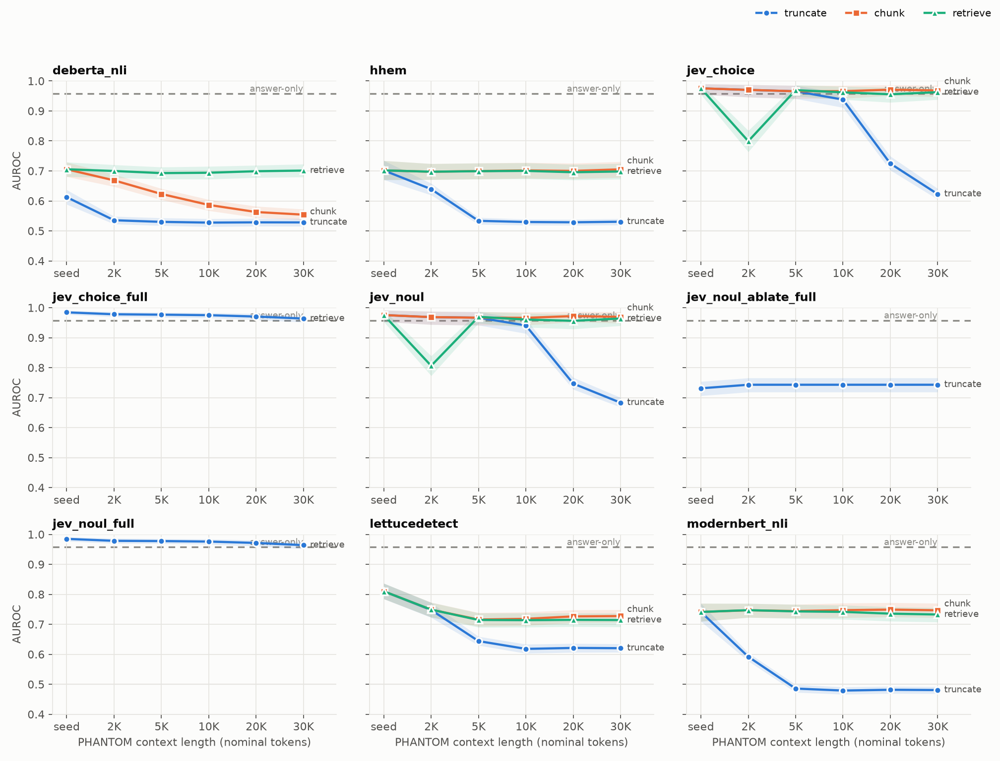
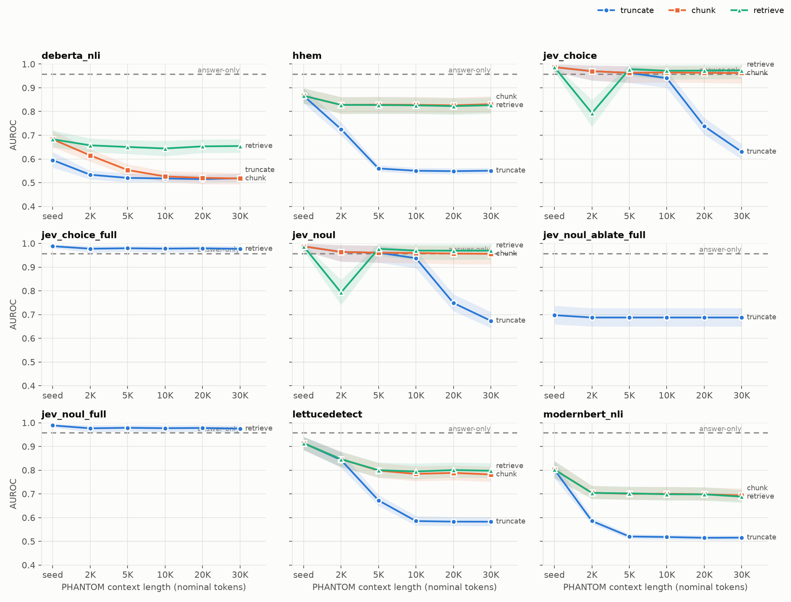
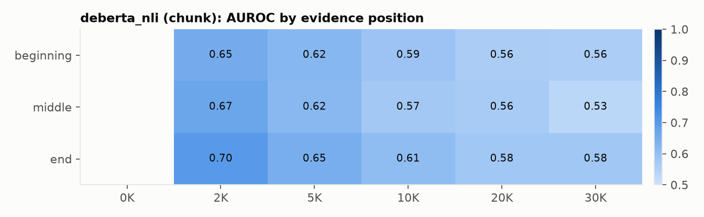
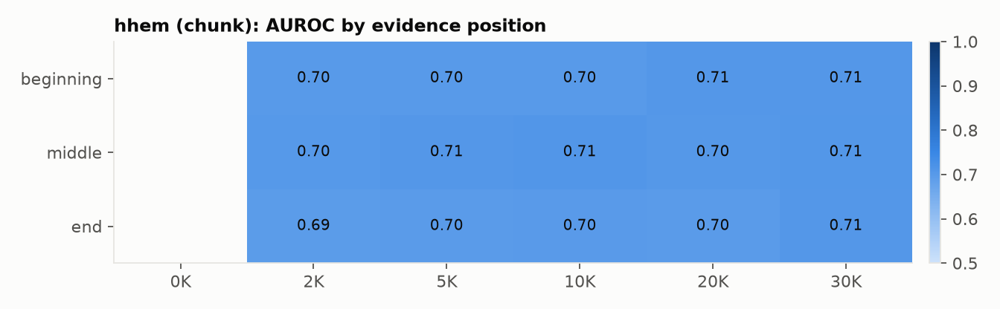
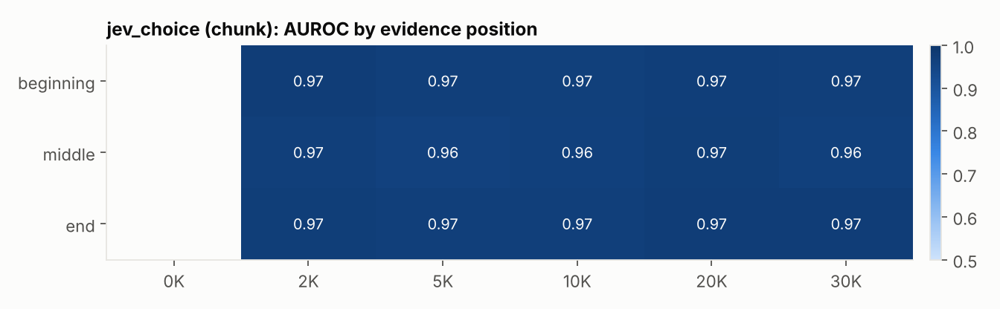
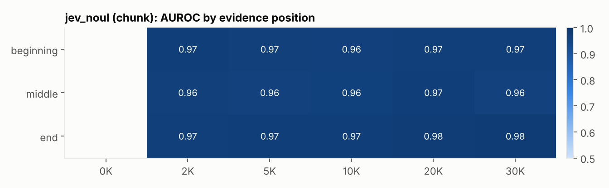
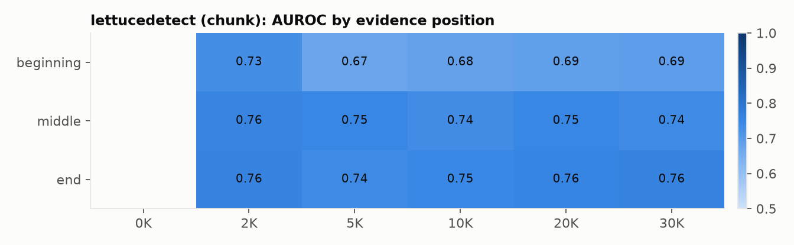
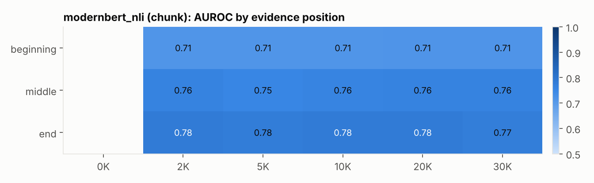

# Length-robust hallucination detection on PHANTOM, RAGTruth and HaluEval

_Generated 2026-10-12 by `python -m src.cli report` from the committed `artifacts/`._

**Pipeline status.** Done: prepare, baselines, score-smoke, score-zeroshot, probe-jev, judge-jev, finetune, evaluate. Pending: rewrite-halueval, probe-api, judges-api, score-finetuned, judge-local, report. Sections that depend on pending stages say so explicitly.

## Research question

How do hallucination detectors degrade as the context grows from a ~500-token passage to 30K nominal tokens and as the evidence moves to the beginning, middle or end, and does chunked or retrieval-based verification recover the loss? Every detector is evaluated next to answer-only shortcut baselines, because all three benchmarks can be partly solved without reading the context.

## Shortcut audit

AUROC of baselines trained on each benchmark's training split. `answer_length` and `answer_tfidf` never see the context; `lexical_support` is 1 minus the share of the answer's content words found in the context. PHANTOM baselines are trained on 8-K/497K and tested on 10-K/DEF 14A at every length.

| eval | answer_length | answer_tfidf | lexical_support |
|---|---|---|---|
| halueval_test | 0.982 | 0.968 | 0.895 |
| phantom_grid_full | 0.835 | 0.957 | 0.836 |
| ragtruth_test | 0.685 | 0.808 | 0.783 |

A detector only demonstrates that it uses the context where it beats the answer-only line, or on the length-matched hard subset where the answer-only signal is weaker.

## Data

- HaluEval QA: 10000 questions (20000 rows). RAGTruth: 14942 train / 2675 test responses.
- PHANTOM: 4 seed files plus 30 long-context files (10-K and DEF 14A at 2K-30K tokens x 3 positions). Long rows are joined to their seed pair; 2086 of 13462 long-file pairs have answers regenerated relative to the seed (`variant=reanswered`; 10k: 0 of 6757 (0%); def14a: 2086 of 6705 (31%)).
- Splits are grouped by pair: PHANTOM 10-K and DEF 14A are test-only at every length; 8-K/497K are train/val; HaluEval 70/15/15; RAGTruth official test, train split 85/15. `grid_sub` = 200 pairs per test filing present in every cell.
- Full statistics and tokenizer measurements: [`artifacts/data_card.md`](../artifacts/data_card.md).

## Results

AUROC with 95% pair-clustered bootstrap CIs. Thresholds for F1 and balanced accuracy are chosen on validation slices only.

| detector | strategy | halueval_test | phantom_grid_full | phantom_grid_full (hard) | phantom_grid_sub | phantom_grid_sub (hard) | phantom_seed_test | phantom_seed_test (hard) | ragtruth_test |
|---|---|---|---|---|---|---|---|---|---|
| answer_length | none | 0.982 [0.977, 0.986] | 0.835 [0.820, 0.850] | 0.732 [0.713, 0.755] | nan | nan | nan | nan | 0.685 [0.663, 0.707] |
| answer_tfidf | none | 0.968 [0.962, 0.974] | 0.957 [0.950, 0.965] | 0.888 [0.869, 0.908] | nan | nan | nan | nan | 0.808 [0.787, 0.828] |
| deberta_nli | chunk-w400-o128-min_phalluc | 0.799 [0.784, 0.813] | nan | nan | 0.600 [0.584, 0.614] | 0.553 [0.535, 0.572] | nan | nan | 0.592 [0.568, 0.615] |
| deberta_nli | retrieve-w400-o128-min_phalluc-k3-bidf | 0.799 [0.784, 0.813] | nan | nan | 0.698 [0.677, 0.717] | 0.654 [0.625, 0.682] | nan | nan | 0.596 [0.573, 0.619] |
| deberta_nli | truncate-w400 | 0.799 [0.784, 0.813] | nan | nan | 0.535 [0.523, 0.547] | 0.525 [0.510, 0.543] | nan | nan | 0.597 [0.574, 0.621] |
| hhem | chunk-w2048-o1024-min_phalluc | 0.737 [0.723, 0.751] | nan | nan | 0.701 [0.675, 0.727] | 0.831 [0.796, 0.863] | nan | nan | 0.824 [0.806, 0.841] |
| hhem | retrieve-w2048-o1024-min_phalluc-k2-bidf | 0.737 [0.723, 0.751] | nan | nan | 0.698 [0.672, 0.725] | 0.828 [0.793, 0.861] | nan | nan | 0.824 [0.806, 0.841] |
| hhem | truncate-w2048 | 0.737 [0.723, 0.751] | nan | nan | 0.552 [0.542, 0.562] | 0.586 [0.574, 0.599] | nan | nan | 0.824 [0.806, 0.841] |
| hhem_ablate | truncate-w2048__ablate | 0.319 [0.302, 0.334] | nan | nan | nan | nan | 0.384 [0.365, 0.405] | 0.502 [0.475, 0.529] | 0.395 [0.371, 0.420] |
| jev_choice | chunk-w16000-o2048-min_phalluc | 0.920 [0.903, 0.935] | nan | nan | 0.969 [0.946, 0.986] | 0.966 [0.926, 0.992] | nan | nan | 0.925 [0.905, 0.945] |
| jev_choice | retrieve-w1500-o750-min_phalluc-k2 | 0.920 [0.903, 0.935] | nan | nan | 0.930 [0.909, 0.948] | 0.937 [0.903, 0.963] | nan | nan | 0.928 [0.908, 0.946] |
| jev_choice | retrieve-w1500-o750-min_phalluc-k2-bidf | 0.920 [0.903, 0.935] | nan | nan | 0.968 [0.947, 0.986] | 0.975 [0.941, 0.997] | nan | nan | 0.928 [0.908, 0.946] |
| jev_choice | truncate-w16000 | 0.920 [0.903, 0.935] | nan | nan | 0.832 [0.813, 0.849] | 0.839 [0.806, 0.866] | nan | nan | 0.925 [0.905, 0.945] |
| jev_choice_full | retrieve-w1500-o750-min_phalluc-k2-bidf | nan | nan | nan | 0.973 [0.965, 0.981] | 0.979 [0.964, 0.990] | nan | nan | nan |
| jev_noul | chunk-w16000-o2048-min_phalluc | 0.945 [0.931, 0.956] | nan | nan | 0.969 [0.946, 0.986] | 0.961 [0.919, 0.990] | nan | nan | 0.926 [0.906, 0.945] |
| jev_noul | retrieve-w1500-o750-min_phalluc-k2 | 0.945 [0.931, 0.956] | nan | nan | 0.930 [0.909, 0.948] | 0.935 [0.901, 0.961] | nan | nan | 0.929 [0.910, 0.947] |
| jev_noul | retrieve-w1500-o750-min_phalluc-k2-bidf | 0.945 [0.931, 0.956] | nan | nan | 0.968 [0.946, 0.986] | 0.972 [0.938, 0.997] | nan | nan | 0.929 [0.910, 0.947] |
| jev_noul | truncate-w16000 | 0.945 [0.931, 0.956] | nan | nan | 0.840 [0.821, 0.856] | 0.844 [0.811, 0.872] | nan | nan | 0.926 [0.906, 0.945] |
| jev_noul_ablate | truncate-w16000__ablate | 0.654 [0.624, 0.681] | nan | nan | nan | nan | 0.746 [0.720, 0.774] | 0.678 [0.636, 0.726] | 0.518 [0.504, 0.533] |
| jev_noul_ablate_full | truncate-w16000__ablate | nan | nan | nan | 0.742 [0.718, 0.765] | 0.688 [0.651, 0.728] | nan | nan | nan |
| jev_noul_full | retrieve-w1500-o750-min_phalluc-k2-bidf | nan | nan | nan | 0.974 [0.966, 0.982] | 0.978 [0.962, 0.989] | nan | nan | nan |
| lettucedetect | chunk-w3584-o1536-min_phalluc | 0.823 [0.808, 0.837] | nan | nan | 0.733 [0.711, 0.755] | 0.809 [0.780, 0.839] | nan | nan | 0.883 [0.866, 0.898] |
| lettucedetect | retrieve-w3584-o1536-min_phalluc-k2-bidf | 0.823 [0.808, 0.837] | nan | nan | 0.727 [0.704, 0.749] | 0.816 [0.786, 0.847] | nan | nan | 0.883 [0.866, 0.898] |
| lettucedetect | truncate-w3584 | 0.823 [0.808, 0.837] | nan | nan | 0.641 [0.628, 0.655] | 0.649 [0.631, 0.668] | nan | nan | 0.883 [0.866, 0.898] |
| lexical_support | full_context | 0.895 [0.881, 0.907] | 0.836 [0.819, 0.852] | 0.814 [0.796, 0.832] | nan | nan | nan | nan | 0.783 [0.764, 0.803] |
| modernbert_nli | chunk-w1536-o1024-min_phalluc | 0.826 [0.814, 0.839] | nan | nan | 0.746 [0.723, 0.769] | 0.706 [0.682, 0.736] | nan | nan | 0.767 [0.749, 0.788] |
| modernbert_nli | retrieve-w1536-o1024-min_phalluc-k2-bidf | 0.826 [0.814, 0.839] | nan | nan | 0.740 [0.716, 0.762] | 0.705 [0.680, 0.735] | nan | nan | 0.767 [0.749, 0.787] |
| modernbert_nli | truncate-w1536 | 0.826 [0.814, 0.839] | nan | nan | 0.514 [0.503, 0.524] | 0.539 [0.530, 0.547] | nan | nan | 0.766 [0.748, 0.786] |
| modernbert_nli_ablate | truncate-w1536__ablate | 0.256 [0.241, 0.271] | nan | nan | nan | nan | 0.244 [0.225, 0.262] | 0.465 [0.446, 0.483] | 0.578 [0.551, 0.604] |

### phantom_grid_sub: AUROC vs context length (all pairs)

### phantom_grid_sub: AUROC vs context length (hard subset)

### Paired comparisons (AUROC difference a - b, same rows)

| detector | slice | a | b | n | diff | ci_lo | ci_hi | p_value |
|---|---|---|---|---|---|---|---|---|
| deberta_nli | phantom_grid_sub | chunk-w400-o128-min_phalluc | deberta_nli:truncate-w400 | 12800 | 0.064 | 0.051 | 0.079 | 0.000 |
| deberta_nli | phantom_grid_sub | retrieve-w400-o128-min_phalluc-k3-bidf | deberta_nli:truncate-w400 | 12800 | 0.163 | 0.146 | 0.180 | 0.000 |
| deberta_nli | phantom_grid_sub | chunk-w400-o128-min_phalluc | answer_tfidf:answer_tfidf | 12800 | -0.356 | -0.374 | -0.339 | 0.000 |
| deberta_nli | phantom_grid_sub | retrieve-w400-o128-min_phalluc-k3-bidf | answer_tfidf:answer_tfidf | 12800 | -0.257 | -0.280 | -0.235 | 0.000 |
| deberta_nli | phantom_grid_sub | truncate-w400 | answer_tfidf:answer_tfidf | 12800 | -0.420 | -0.435 | -0.404 | 0.000 |
| hhem | phantom_grid_sub | chunk-w2048-o1024-min_phalluc | hhem:truncate-w2048 | 12800 | 0.148 | 0.127 | 0.167 | 0.000 |
| hhem | phantom_grid_sub | retrieve-w2048-o1024-min_phalluc-k2-bidf | hhem:truncate-w2048 | 12800 | 0.146 | 0.125 | 0.165 | 0.000 |
| hhem | phantom_grid_sub | chunk-w2048-o1024-min_phalluc | answer_tfidf:answer_tfidf | 12800 | -0.254 | -0.285 | -0.226 | 0.000 |
| hhem | phantom_grid_sub | retrieve-w2048-o1024-min_phalluc-k2-bidf | answer_tfidf:answer_tfidf | 12800 | -0.257 | -0.287 | -0.228 | 0.000 |
| hhem | phantom_grid_sub | truncate-w2048 | answer_tfidf:answer_tfidf | 12800 | -0.403 | -0.419 | -0.387 | 0.000 |
| jev_choice | phantom_grid_sub | chunk-w16000-o2048-min_phalluc | jev_choice:truncate-w16000 | 3840 | 0.136 | 0.126 | 0.147 | 0.000 |
| jev_choice | phantom_grid_sub | retrieve-w1500-o750-min_phalluc-k2-bidf | jev_choice:truncate-w16000 | 3840 | 0.136 | 0.124 | 0.148 | 0.000 |
| jev_choice | phantom_grid_sub | retrieve-w1500-o750-min_phalluc-k2 | jev_choice:truncate-w16000 | 3840 | 0.098 | 0.086 | 0.110 | 0.000 |
| jev_choice | phantom_grid_sub | chunk-w16000-o2048-min_phalluc | answer_tfidf:answer_tfidf | 3840 | 0.014 | -0.016 | 0.048 | 0.420 |
| jev_choice | phantom_grid_sub | retrieve-w1500-o750-min_phalluc-k2-bidf | answer_tfidf:answer_tfidf | 3840 | 0.014 | -0.016 | 0.046 | 0.428 |
| jev_choice | phantom_grid_sub | retrieve-w1500-o750-min_phalluc-k2 | answer_tfidf:answer_tfidf | 3840 | -0.025 | -0.058 | 0.010 | 0.136 |
| jev_choice | phantom_grid_sub | truncate-w16000 | answer_tfidf:answer_tfidf | 3840 | -0.122 | -0.153 | -0.088 | 0.000 |
| jev_choice_full | phantom_grid_sub | retrieve-w1500-o750-min_phalluc-k2-bidf | answer_tfidf:answer_tfidf | 12800 | 0.018 | 0.004 | 0.033 | 0.012 |
| jev_noul | phantom_grid_sub | chunk-w16000-o2048-min_phalluc | jev_noul:truncate-w16000 | 3840 | 0.129 | 0.119 | 0.139 | 0.000 |
| jev_noul | phantom_grid_sub | retrieve-w1500-o750-min_phalluc-k2-bidf | jev_noul:truncate-w16000 | 3840 | 0.128 | 0.117 | 0.139 | 0.000 |
| jev_noul | phantom_grid_sub | retrieve-w1500-o750-min_phalluc-k2 | jev_noul:truncate-w16000 | 3840 | 0.090 | 0.079 | 0.102 | 0.000 |
| jev_noul | phantom_grid_sub | chunk-w16000-o2048-min_phalluc | answer_tfidf:answer_tfidf | 3840 | 0.015 | -0.017 | 0.048 | 0.400 |
| jev_noul | phantom_grid_sub | retrieve-w1500-o750-min_phalluc-k2-bidf | answer_tfidf:answer_tfidf | 3840 | 0.013 | -0.018 | 0.046 | 0.456 |
| jev_noul | phantom_grid_sub | retrieve-w1500-o750-min_phalluc-k2 | answer_tfidf:answer_tfidf | 3840 | -0.024 | -0.058 | 0.009 | 0.152 |
| jev_noul | phantom_grid_sub | truncate-w16000 | answer_tfidf:answer_tfidf | 3840 | -0.114 | -0.144 | -0.081 | 0.000 |
| jev_noul_ablate_full | phantom_grid_sub | truncate-w16000__ablate | answer_tfidf:answer_tfidf | 12800 | -0.213 | -0.236 | -0.188 | 0.000 |
| jev_noul_full | phantom_grid_sub | retrieve-w1500-o750-min_phalluc-k2-bidf | answer_tfidf:answer_tfidf | 12800 | 0.019 | 0.005 | 0.033 | 0.008 |
| lettucedetect | phantom_grid_sub | chunk-w3584-o1536-min_phalluc | lettucedetect:truncate-w3584 | 12800 | 0.092 | 0.075 | 0.106 | 0.000 |
| lettucedetect | phantom_grid_sub | retrieve-w3584-o1536-min_phalluc-k2-bidf | lettucedetect:truncate-w3584 | 12800 | 0.086 | 0.068 | 0.102 | 0.000 |
| lettucedetect | phantom_grid_sub | chunk-w3584-o1536-min_phalluc | answer_tfidf:answer_tfidf | 12800 | -0.222 | -0.250 | -0.193 | 0.000 |
| lettucedetect | phantom_grid_sub | retrieve-w3584-o1536-min_phalluc-k2-bidf | answer_tfidf:answer_tfidf | 12800 | -0.228 | -0.258 | -0.198 | 0.000 |
| lettucedetect | phantom_grid_sub | truncate-w3584 | answer_tfidf:answer_tfidf | 12800 | -0.314 | -0.333 | -0.295 | 0.000 |
| modernbert_nli | phantom_grid_sub | chunk-w1536-o1024-min_phalluc | modernbert_nli:truncate-w1536 | 12800 | 0.232 | 0.211 | 0.251 | 0.000 |
| modernbert_nli | phantom_grid_sub | retrieve-w1536-o1024-min_phalluc-k2-bidf | modernbert_nli:truncate-w1536 | 12800 | 0.226 | 0.204 | 0.244 | 0.000 |
| modernbert_nli | phantom_grid_sub | chunk-w1536-o1024-min_phalluc | answer_tfidf:answer_tfidf | 12800 | -0.209 | -0.234 | -0.184 | 0.000 |
| modernbert_nli | phantom_grid_sub | retrieve-w1536-o1024-min_phalluc-k2-bidf | answer_tfidf:answer_tfidf | 12800 | -0.215 | -0.241 | -0.192 | 0.000 |
| modernbert_nli | phantom_grid_sub | truncate-w1536 | answer_tfidf:answer_tfidf | 12800 | -0.441 | -0.458 | -0.425 | 0.000 |

## Fine-tuning

| run | base | train_rows | val_auroc | minutes |
|---|---|---|---|---|
| modernbert-nli-ft_seed42 | tasksource/ModernBERT-base-nli | 26592 | 0.913 | 161.200 |

## Discussion

_To be written once the GPU stages are complete. It must discuss each result against the answer-only line and the hard subset, not in isolation._

## Limitations

- All three benchmarks contain answer-only signal (see the shortcut audit); absolute scores overstate grounding.
- PHANTOM's long variants are built around a single 500-token evidence passage, so `min_phalluc` (any window supports the answer) suits it; claims needing evidence from several windows are not tested.
- 512-token models (DeBERTa) cannot hold most seed passages in one window; their results are partial-evidence results.
- `grid_sub` uses 200 pairs per filing per cell; CIs reflect this.
- API judges (Jev, Dartmouth Chat, Gemini) can change behind the same name; each run records the model id that answered, and Jev is pinned to `jev-1.13.0` rather than the moving `jev-latest` alias.
- Jev results use a 60-pair-per-cell PHANTOM sample (cost); its CIs are wider than the encoders' 200-pair grid.

## Reproducibility

Pinned revisions:

- `pminervini/HaluEval` @ `12a856119f03`
- `seyled/Phantom_Hallucination_Detection` @ `11406c015385`
- `wandb/RAGTruth-processed` @ `eb4f4b9d1b68`
- `vectara/hallucination_evaluation_model` @ `de9a5e6ba9ba`
- `tasksource/ModernBERT-base-nli` @ `de4ab7e77845`
- `MoritzLaurer/DeBERTa-v3-base-mnli-fever-anli` @ `6f5cf0a2b59c`
- `KRLabsOrg/lettucedect-base-modernbert-en-v1` @ `bbd77832f52f`
- `Qwen/Qwen3-4B-Instruct-2507` @ `cdbee75f17c0`
- `Qwen/Qwen3-8B` @ `b968826d9c46`
- TypeSafe Jev API, model pinned to `jev-1.13.0` (served model ids are recorded in `artifacts/predictions/manifest/`); 16855 live requests, 84,174,142 input tokens, $3.54

Run `python -m src.cli status` to see how each artifact is produced.
